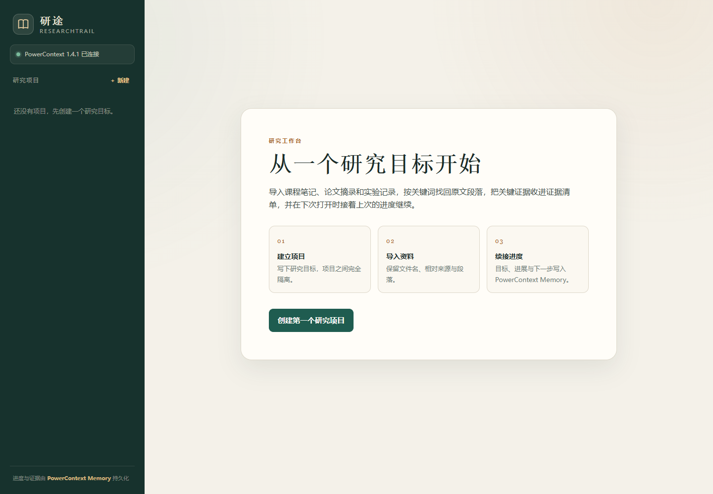
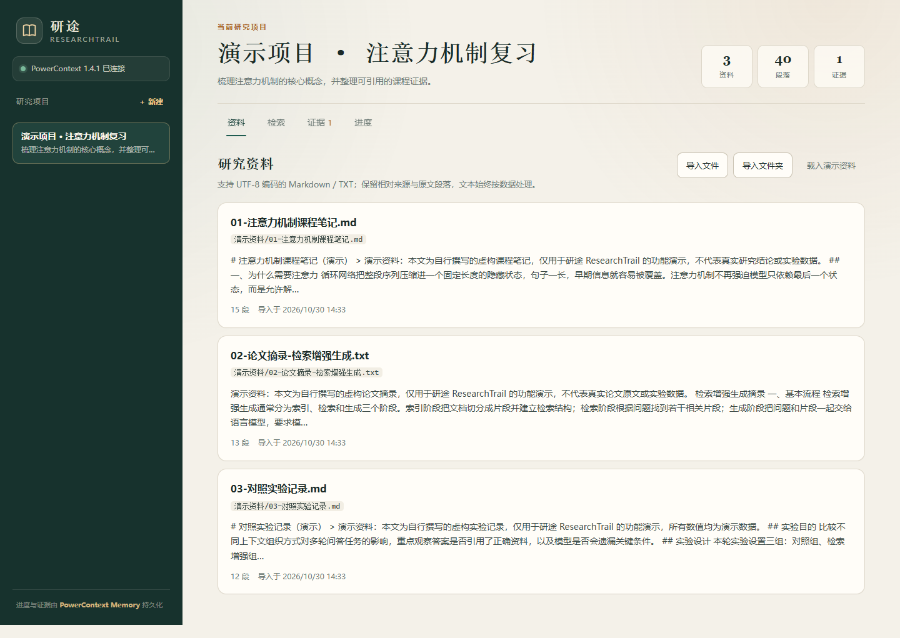
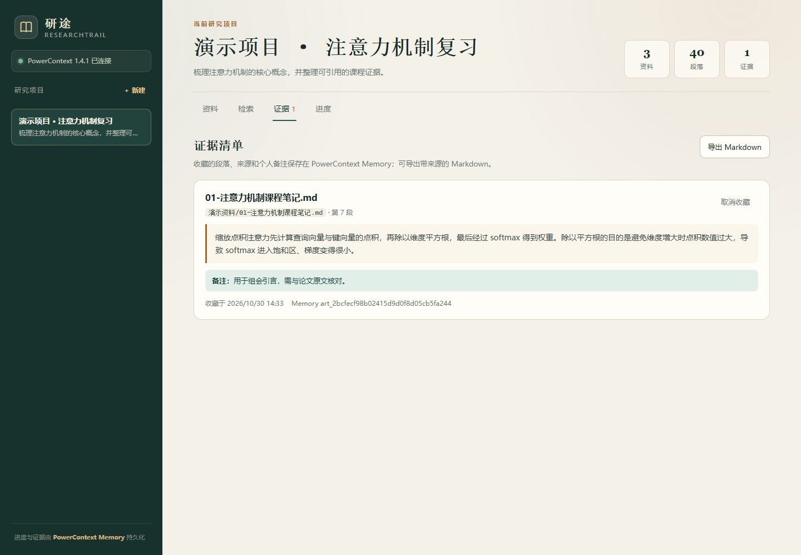

# 研途 ResearchTrail

面向学习与科研的资料证据工作台：把课程笔记、论文摘录和实验记录导入项目，按关键词找回原文段落，收藏关键证据并记录个人备注；研究目标、进度和证据由 **PowerContext Memory** 真实持久化，关闭进程后重新打开仍可继续。

- 技术栈：Python 3.12 · FastAPI · SQLite · PowerContext 1.4.1（Atomic Memory HTTP API）
- 界面：中文单页研究工作台，无前端构建步骤
- 示例资料：`samples/` 下三份**自行撰写的合成笔记**，仅用于演示，不代表真实研究结论
- 实测环境：Windows 10.0.26200 x64、Python 3.12.13、Chrome（headless UI 验证）



## 解决的痛点

整理一篇文献综述时，常见的问题是：资料散落在课程笔记、论文摘录和实验记录里；几周后只记得“看过一段相关论述”，却找不到原文和出处；下次继续研究时，又要重新回忆上次做到哪里。通用笔记软件能存全文，却不擅长把**原文段落、来源、个人备注和研究进度**放在同一条工作流里。

研途把这条链路收紧为四步：建立研究项目 → 导入资料 → 检索并收藏证据 → 保存进度并续接。项目之间完全隔离；证据清单可导出为带来源的 Markdown，汇报和写作时可直接核对原文。

## 核心功能

| 功能 | 说明 |
| --- | --- |
| 研究项目 | 每个项目是一个 PowerContext Scope，携带 `researchtrail.project=v1` 外部标记；项目列表只展示这类 Scope |
| 资料导入 | 支持 UTF-8 Markdown / TXT，保留文件名、相对来源、段落、摘要；单文件 2 MB、单次 20 个、单项目 200 份 |
| 关键词检索 | 在当前项目内检索原文段落，返回资料名、相对来源、段号，并高亮关键词；无匹配时明确提示 |
| 证据收藏 | 段落 + 原文 + 来源 + 段号 + 个人备注写入 PowerContext Memory；同一段落重复收藏会被拒绝 |
| Markdown 导出 | 生成带研究目标、来源、段号、原文和备注的证据清单，文件名支持中文 |
| 进度续接 | 研究目标、已完成工作、下一步写入 PowerContext Memory；旧版本通过 lifecycle 归档，最新版本恢复 |
| 项目隔离 | 资料、检索、证据、进度均按 Scope 隔离；其他项目无法检索或收藏本项目段落 |
| 错误与空态 | 空项目、空资料、空证据、无匹配、空检索词、PowerContext 离线、窄屏均有明确界面反馈 |

| 资料与检索 | 证据清单 |
| --- | --- |
|  |  |

## 架构与指定技术的作用

```text
浏览器（纯静态 SPA，textContent 渲染 + 严格 CSP）
        │  /api/*
        ▼
FastAPI 应用（app/main.py）
        ├── 资料库：本地 SQLite（documents / paragraphs，参数化 LIKE 检索）
        └── 项目 / 进度 / 证据：PowerContext HTTP API（127.0.0.1:8765）
                                      │
                                      ▼
                            POWERCONTEXT_HOME/powercontext.db
```

**PowerContext 是核心依赖，不是可选组件。** 应用直接调用其 Python SDK 的 Atomic Memory API：

| 应用动作 | PowerContext API / 数据 |
| --- | --- |
| 新建项目 | `create_scope`，Scope 携带外部引用 `researchtrail.project=v1` |
| 项目列表 / 项目校验 | `list_scopes` / `get_scope`，按外部引用标记过滤非本项目 Scope |
| 保存进度 | `remember_memory`（kind=`research.progress`），旧记录用 `change_atomic_memory_lifecycle(state=forgotten)` 归档 |
| 收藏证据 | `remember_memory`（kind=`research.evidence`），内容包含段号、原文、来源与备注 |
| 恢复进度 / 证据 | `list_memory_entries`，只取 `active` 状态记录；最新进度按 `updated_at` 选择 |
| 删除证据 | `change_atomic_memory_lifecycle(state=forgotten)`，不物理删除历史 |

资料正文保存在本地 SQLite，是因为本作品需要按项目做参数化全文匹配与重复导入检测；**项目状态、证据与进度不落 JSON 文件，全部由 PowerContext 负责**。本版本未接入 seekdb，以避免为凑组件数量牺牲完整性。

## 目录

```text
qoder/
├── app/
│   ├── main.py            # FastAPI 路由、安全响应头、导出、错误映射
│   ├── memory.py          # PowerContext Scope / Memory 网关
│   ├── db.py              # 资料与段落 SQLite 存储、参数化检索
│   ├── documents.py       # UTF-8 校验、路径规范化、段落切分
│   ├── models.py          # 输入模型与标识校验
│   ├── config.py          # 环境变量与 .env 加载
│   └── static/            # 中文单页界面（无需构建）
├── samples/               # 3 份自行撰写的合成演示资料
├── scripts/
│   ├── run.py             # 一键启动 PowerContext + 应用
│   ├── start.ps1/.sh      # 调用 run.py 的入口脚本
│   ├── verify_acceptance.py  # 22 项真实端到端验收（含跨进程重启）
│   └── ui_check.py        # Chrome 浏览器 UI 验证与截图
├── evidence/
│   ├── logs/              # 验收原始结果、服务日志、UI 检查结果
│   └── screenshots/       # 真实界面截图
├── requirements.txt       # 固定直接依赖
├── requirements.lock      # 完整传递依赖冻结（122 个包）
├── requirements-dev.txt   # 仅 UI 自动化需要的 Playwright
└── .env.example           # 环境变量占位示例（不含任何凭据）
```

## 安装与启动（Windows）

前置：Python 3.12、[uv](https://docs.astral.sh/uv/)，或可用的 pip。

```powershell
cd ecosystem\qoder

# 1. 创建隔离环境并安装固定依赖
uv venv .venv --python 3.12
uv pip install --python .venv\Scripts\python.exe -r requirements.txt

# 2. 准备本地配置（可选；不复制也会使用相同的默认值）
Copy-Item .env.example .env

# 3. 一键启动（自动拉起 PowerContext Server，再启动 Web 应用）
.\scripts\start.ps1
```

打开 <http://127.0.0.1:8000>。首次启动会在 `data/` 下创建应用数据库、PowerContext 数据目录和服务日志；按 `Ctrl+C` 会同时停止两个进程。

Linux / macOS 使用 `scripts/start.sh`（脚本已提供，本次未在非 Windows 环境实跑）。

### 手动分步启动

```powershell
# 终端 1：PowerContext Server（SQLite 后端要求 role=all）
$env:POWERCONTEXT_HOME = "$PWD\data\powercontext"
.\.venv\Scripts\powercontext.exe server run --host 127.0.0.1 --port 8765 --role all --no-env-file

# 终端 2：Web 应用
.\scripts\start.ps1 --reuse
```

`scripts/run.py --reuse` 会复用已运行的 PowerContext Server；不传参数时若检测到端口已占用也会提示并复用。

## 验证样例（可逐步复现）

演示资料内容与段落数：

| 文件 | 段落数 | 用途 |
| --- | --- | --- |
| `samples/01-注意力机制课程笔记.md` | 15 | 课程笔记与缩放点积 / 多头注意力 |
| `samples/02-论文摘录-检索增强生成.txt` | 13 | RAG 流程、切分与引用核对 |
| `samples/03-对照实验记录.md` | 12 | 三组对照实验与下一步计划 |

1. 启动后点击「创建第一个研究项目」，名称填“演示项目 · 注意力机制复习”，目标填“梳理注意力机制的核心概念，并整理可引用的课程证据。”
2. 在「资料」页点击「载入演示资料」，应提示“已导入 3 份资料”，统计显示 3 份资料 / 40 段。
3. 切到「检索」，输入 `缩放点积注意力`，应返回 **2 个匹配段落**；第 7 段正文以“缩放点积注意力先计算查询向量与键向量的点积”开头，来源为 `演示资料/01-注意力机制课程笔记.md`。
4. 在该结果点击「收藏证据」，填写备注“用于组会引言，需与论文原文核对。”并保存；「证据」页应出现 1 条记录，含原文、来源、段号和备注。
5. 点击「导出 Markdown」，导出文件应包含上述原文、来源 `演示资料/01-注意力机制课程笔记.md` 和备注。
6. 切到「进度」，填写已完成工作与下一步并保存；界面显示 `Memory art_…` 记录标识。
7. 结束应用与 PowerContext 进程后重新启动，同一项目应恢复资料、证据和进度；另建一个项目，不应看到前一个项目的资料或证据。
8. 检索不存在的词（如 `量子纠缠冷聚变`）应提示未找到；空检索词应提示输入关键词。

## 自动化验收

```powershell
# 需要先安装开发依赖（仅 UI 验证需要）
uv pip install --python .venv\Scripts\python.exe -r requirements-dev.txt

# 22 项端到端验收：独立数据目录、独立端口，真实杀进程后重启校验
.\.venv\Scripts\python.exe scripts\verify_acceptance.py

# 13 项浏览器 UI 验证：生成截图，覆盖窄屏、空态、无匹配、离线提示
# 需先按上一节启动 http://127.0.0.1:8000
.\.venv\Scripts\python.exe scripts\ui_check.py
```

### 实测结果（2026-10-30）

| 项目 | 结果 | 原始材料 |
| --- | --- | --- |
| 端到端验收 | **22/22 通过** | `evidence/logs/acceptance.md`、`acceptance.json`、`servers.log` |
| 浏览器 UI | **13/13 通过，控制台 0 错误** | `evidence/logs/ui-check.md`、`ui-check.json` |
| 跨进程重启 | 两份项目的不同进度、证据与资料均准确恢复 | `acceptance.json` 中 `phase1` / `phase2` 状态快照 |
| 隔离性 | B 项目检索 0 条、证据 0 条，跨项目收藏返回 400 | `acceptance.md` 第 13 项 |

验收覆盖：健康检查、项目创建、演示资料导入、来源/摘要/段数、关键词命中、无匹配、空检索、重复导入、证据收藏与备注、重复收藏、Markdown 导出、两份项目不同进度、项目隔离、非法项目/证据标识、PowerContext Scope 标记与 Memory 记录、结束进程后重启恢复。

本次验收由 PowerContext 1.4.1 + 独立 SQLite 数据目录真实执行；`servers.log` 保留了完整启动与请求记录。未使用真实用户数据，因此不声明使用人数或提效比例。

## API 摘要

| 方法 | 路径 | 说明 |
| --- | --- | --- |
| GET | `/api/health` | 应用、SQLite、PowerContext 健康状态 |
| GET / POST | `/api/projects` | 列出 / 创建项目 |
| GET | `/api/projects/{id}` | 项目详情与资料/段落/证据统计 |
| GET / POST | `/api/projects/{id}/documents` | 列出 / 导入资料（multipart） |
| POST | `/api/projects/{id}/demo` | 导入内置合成演示资料 |
| GET | `/api/projects/{id}/search?q=` | 当前项目关键词检索 |
| GET / POST | `/api/projects/{id}/evidence` | 列出 / 收藏证据 |
| DELETE | `/api/projects/{id}/evidence/{evidence_id}` | 取消收藏（Memory lifecycle） |
| GET | `/api/projects/{id}/evidence/export` | 导出 Markdown 证据清单 |
| GET / PUT | `/api/projects/{id}/progress` | 读取 / 保存进度 |

## 数据与安全

- 所有资料来源必须是相对路径；拒绝绝对路径、盘符、`..`、空段和控制字符，文件不落盘，仅解析入 SQLite。
- SQLite 查询全部参数化，`LIKE` 对 `% _ \` 做转义；项目隔离由 `project_id` 条件与 PowerContext Scope 双重约束。
- 前端不使用 `innerHTML`，检索高亮通过 DOM 节点构建；响应带 CSP、`X-Content-Type-Options`、`X-Frame-Options`、`Referrer-Policy`，API 禁用缓存。
- `.env`、虚拟环境、`data/`（含数据库与服务日志）均已加入 `.gitignore`，仓库不包含凭据或个人数据。

## 依赖与来源

| 依赖 | 版本 | 用途 / 许可 |
| --- | --- | --- |
| PowerContext | 1.4.1（PyPI） | Scope / Atomic Memory，Apache-2.0，上游 <https://github.com/oceanbase/powercontext> |
| FastAPI | 0.162.0 | Web API，MIT |
| Uvicorn | 0.54.0 | ASGI Server，BSD-3-Clause |
| aiosqlite | 0.22.1 | 异步 SQLite，MIT |
| Pydantic | 2.14.2 | 输入校验，MIT |
| httpx | 0.28.1 | 验收脚本 HTTP 客户端，BSD-3-Clause |
| python-multipart | 0.0.32 | 文件上传解析，Apache-2.0 |
| python-dotenv | 1.2.4 | `.env` 加载，BSD-3-Clause |
| Playwright（仅开发） | 1.64.1 | UI 自动化，Apache-2.0 |

`requirements.lock` 是在上述 Windows + Python 3.12.13 环境中生成的完整传递依赖冻结；在其它平台安装时，平台相关包会自动替换，建议以 `requirements.txt` 为准复现。

## 已知边界

- 当前为本地单用户工具，无登录与多租户权限；研究项目之间隔离，但同一实例内不区分用户。
- 检索为关键词匹配，未接入语义向量检索或 seekdb；需要同义表达召回时请等待后续版本。
- 示例资料为合成内容，界面与文档中均已标注，不能作为真实研究依据。
- Qoder Sites 展示站与最终提交材料由项目根目录的提交记录维护，不在本 README 中声称已发布。
